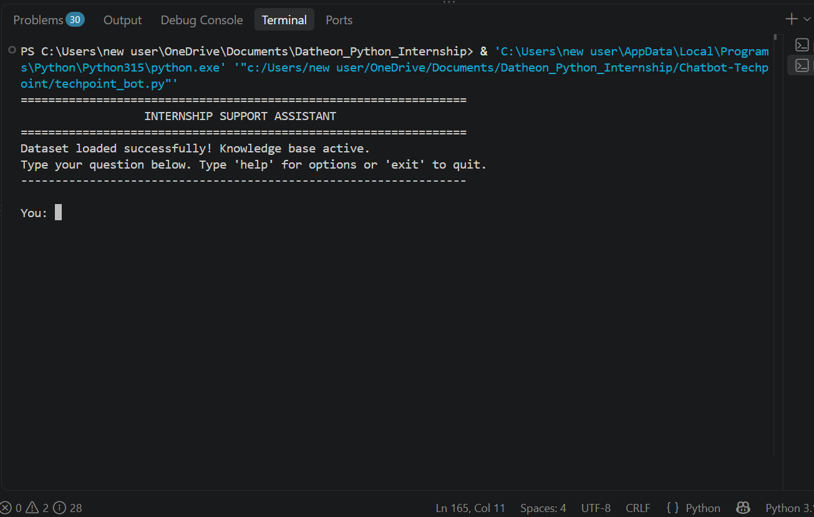
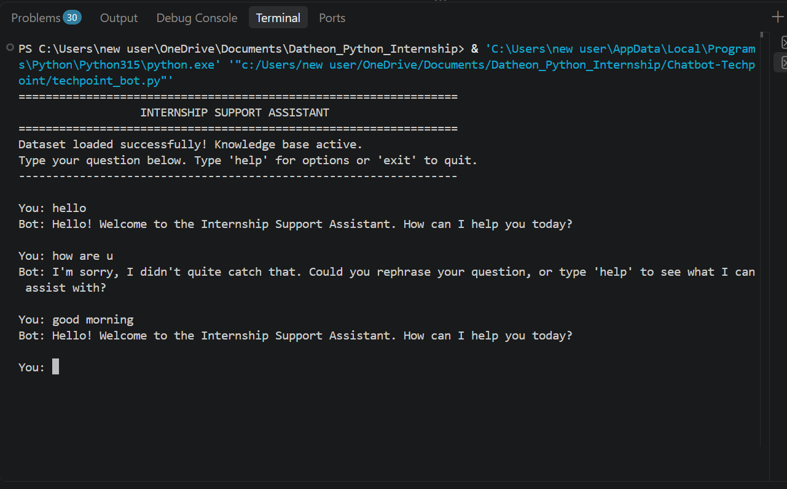
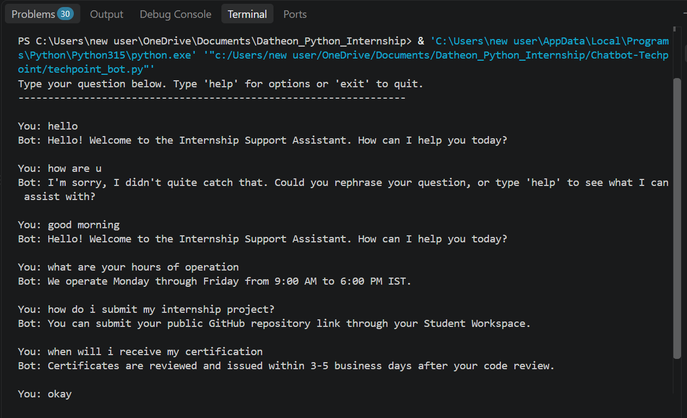
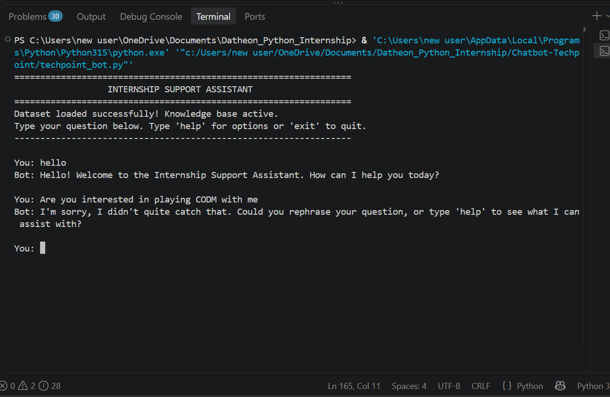
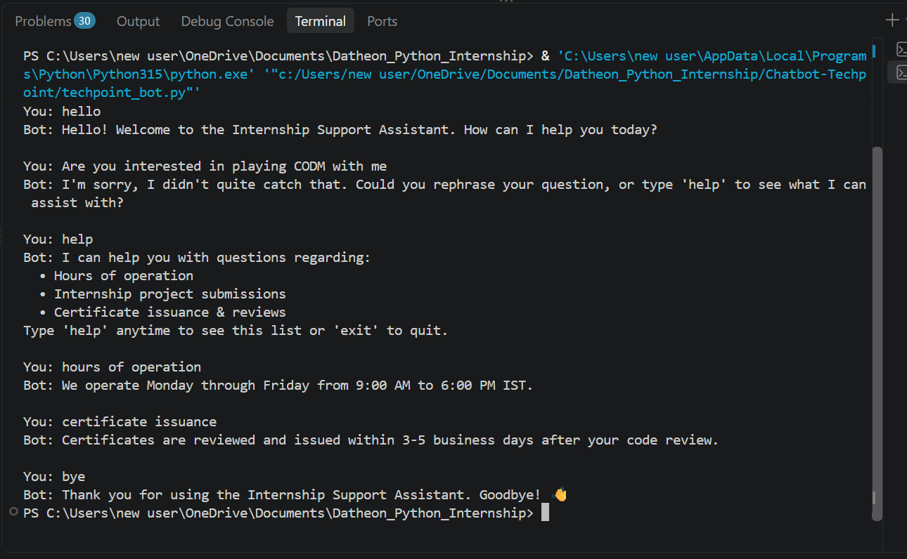

# Rule-Based Interactive Terminal Assistant


## 1. Project Overview

The **Rule-Based Interactive Terminal Assistant** is a Python command-line application developed as part of the Datheon Python Internship.

The project focuses on building a simple automated support assistant capable of recognizing user messages and responding to frequently asked questions through predefined rules.

It uses regular expressions (Regex) to identify relevant keywords and match user queries against predefined intents. The chatbot retrieves its greeting phrases and FAQ responses from an external JSON dataset, making its knowledge base easier to maintain and update without modifying the main Python program.

The assistant is designed to handle common internship-related enquiries, including operating hours, project submission procedures, and certificate processing.

## 2. Project Objectives

The main objectives of this project are to:

- Develop an interactive, rule-based conversational application.
- Implement keyword recognition and pattern matching using regular expressions.
- Integrate an external JSON file as a structured knowledge base.
- Normalize user input before processing.
- Identify and respond to recognized user intents.
- Implement fallback responses for unrecognized queries.
- Provide clean exit commands and appropriate session handling.
- Apply modular programming and error-handling techniques in Python.

## 3. Key Features

### Greeting Recognition
Recognizes common greetings such as:
- Hello
- Hi
- Hey
- Good morning
- Good afternoon

### FAQ-Based Responses
Provides predefined answers to frequently asked internship-related questions, including:
- Operating hours.
- Internship project submission procedures.
- Certificate processing timelines.

### Regex-Based Intent Recognition
Uses Python's `re` module to identify keywords and match user messages against predefined intent patterns.

### Input Normalization
Converts user input to lowercase and removes unnecessary leading and trailing whitespace to improve consistency during matching.

### JSON Dataset Integration
Loads greetings and frequently asked questions from an external `faqs.json` file rather than hardcoding all responses into the main application.

### Fallback Handling
Provides an alternative response when a user's message does not match any recognized intent, encouraging them to rephrase their question.

### Help Command
Allows users to request information about the types of questions the assistant can handle.

### Exit Commands
Supports common exit commands:
- `bye`
- `exit`
- `quit`
- `goodbye`

### Error Handling
Includes handling for:
- Missing JSON dataset files.
- Invalid JSON formatting.
- File access errors.
- Empty user input.
- Keyboard interruption and unexpected end-of-input.

## 4. Technologies and Python Modules

| Technology / Module | Purpose |
|---|---|
| Python 3 | Main programming language |
| `json` | Loading and processing FAQ data |
| `re` | Regular expression and keyword matching |
| `os` | File path handling and dataset location |

**External dependencies:** None. The project uses Python's built-in standard library.

## 5. Project Structure

```text
Project_3_Chatbot/
│
├── chatbot.py
├── faqs.json
├── README.md
│
└── screenshots/
    ├── welcome.png
    ├── greeting.png
    ├── faq-response.png
    ├── fallback.png
    └── exit.png
```

### File Description

- `chatbot.py` – Contains the main chatbot implementation, intent recognition, response generation, and interactive terminal loop.
- `faqs.json` – Stores greeting phrases and predefined FAQ questions and answers.
- `README.md` – Contains the project documentation and execution instructions.
- `screenshots/` – Contains visual demonstrations of the chatbot's functionality.

## 6. How the Application Works

The chatbot follows a simple processing workflow:

1. **Initialization:** The application loads the external JSON dataset.
2. **Input Collection:** The user enters a message through the terminal.
3. **Input Normalization:** The message is converted to lowercase and stripped of unnecessary whitespace.
4. **Intent Identification:** Regular expressions are used to check the message against available intent patterns.
5. **Response Generation:** The chatbot retrieves the corresponding predefined response.
6. **Fallback Processing:** If no intent is recognized, the chatbot returns a fallback message.
7. **Session Management:** The chatbot continues accepting messages until the user enters an exit command or interrupts the session.

## 7. JSON Knowledge Base

The chatbot uses an external JSON file named `faqs.json` to store its greeting phrases and FAQ information.

The dataset follows this structure:

```json
{
  "greetings": [
    "hello",
    "hi",
    "hey",
    "good morning",
    "good afternoon"
  ],
  "faqs": [
    {
      "question": "What are your hours of operation?",
      "answer": "We operate Monday through Friday from 9:00 AM to 6:00 PM IST."
    },
    {
      "question": "How do I submit my internship project?",
      "answer": "You can submit your public GitHub repository link through your Student Workspace."
    },
    {
      "question": "When will I receive my certificate?",
      "answer": "Certificates are reviewed and issued within 3-5 business days after your code review."
    }
  ]
}
```

This approach separates the chatbot's response data from its application logic, making it easier to maintain and expand the FAQ database.

## 8. Installation and Execution

### Prerequisites

- Python 3 installed.
- Visual Studio Code or another Python-compatible editor.
- The project files (`chatbot.py` and `faqs.json`).

### Running the Application

**Step 1:** Download or clone the project repository.

**Step 2:** Open the `Project_3_Chatbot` folder in Visual Studio Code.

**Step 3:** Open the integrated terminal.

**Step 4:** Execute the following command:

```bash
python chatbot.py
```

**Step 5:** Start interacting with the assistant by entering greetings or supported questions.

**Note:** Ensure that `faqs.json` is located in the same directory as `chatbot.py`.

## 9. Sample Interactions

| User Input | Expected Chatbot Behaviour |
|---|---|
| Hello | Returns a greeting |
| What are your hours of operation? | Provides operating hours |
| How do I submit my internship project? | Explains the submission procedure |
| When will I receive my certificate? | Provides certificate processing information |
| Help | Displays available assistance topics |
| An unrelated question | Returns a fallback response |
| Bye | Ends the conversation |

## 10. Application Screenshots

The following screenshots demonstrate the chatbot's execution and major functionalities.

### 10.1 Welcome Screen

Displays the chatbot startup interface, successful dataset initialization, and instructions for interacting with the assistant.



### 10.2 Greeting Recognition

Demonstrates how the chatbot recognizes a greeting and returns an appropriate response.



### 10.3 FAQ Response

Shows the chatbot processing a supported question and retrieving the corresponding answer from the JSON knowledge base.



### 10.4 Fallback Handling

Demonstrates how the chatbot handles an unrecognized question by providing a fallback response.



### 10.5 Exit Functionality

Shows how the chatbot responds to an exit command and terminates the interactive session gracefully.



## 11. Error Handling and Reliability

The application incorporates basic error-handling mechanisms to improve reliability.

These include:

- Checking whether the required JSON file exists before loading it.
- Handling invalid JSON syntax.
- Handling file access and operating system errors.
- Preventing empty messages from being processed.
- Handling keyboard interruptions and end-of-input events.
- Keeping the chatbot operational when an unrecognized query is received.

## 12. Current Scope and Limitations

This project implements a **rule-based chatbot**, not an artificial intelligence or machine-learning conversational model.

Its responses depend on predefined FAQ information and regular-expression matching. Consequently:

- It can only provide answers covered by its configured rules and dataset.
- It does not understand natural language in the way an AI-powered chatbot does.
- Its keyword-based matching may occasionally identify an unrelated FAQ when a message contains a shared keyword.
- It does not retain conversation history or interpret contextual follow-up messages.

These limitations reflect the current implementation and provide opportunities for future improvement.

## 13. Learning Outcomes

Developing this project provided practical experience in:

- Building interactive command-line applications with Python.
- Working with external JSON datasets.
- Applying regular expressions to text processing and pattern recognition.
- Designing modular programs using functions.
- Implementing conditional logic and iterative processing.
- Handling file-related errors and invalid input.
- Developing a basic rule-based conversational system.
- Separating application logic from external data.

## 14. Conclusion

The Rule-Based Interactive Terminal Assistant demonstrates the practical application of Python programming concepts in developing a simple automated support system.

By combining regular expressions, JSON data integration, input normalization, predefined responses, and error handling, the project provides a functional foundation for rule-based conversational applications.

It was developed as part of the **Datheon Python Internship**, with the objective of strengthening practical Python programming, problem-solving, and application development skills.

---

## Author

**ABDRAFIU ABDMOJEED AYOYINKA**

**Project:** Datheon Python Internship – Project 3