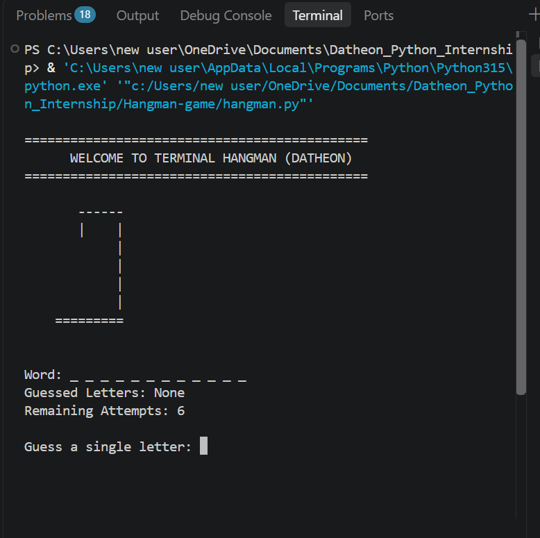
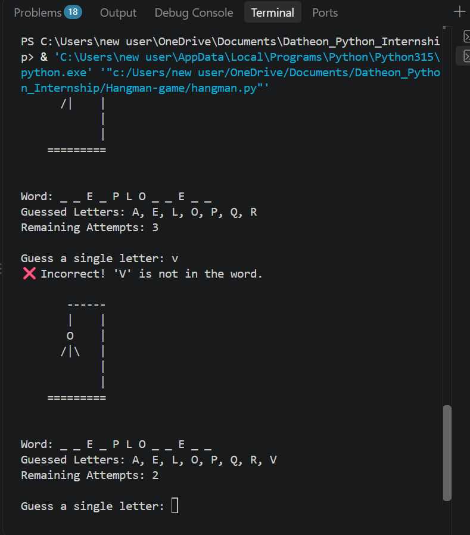
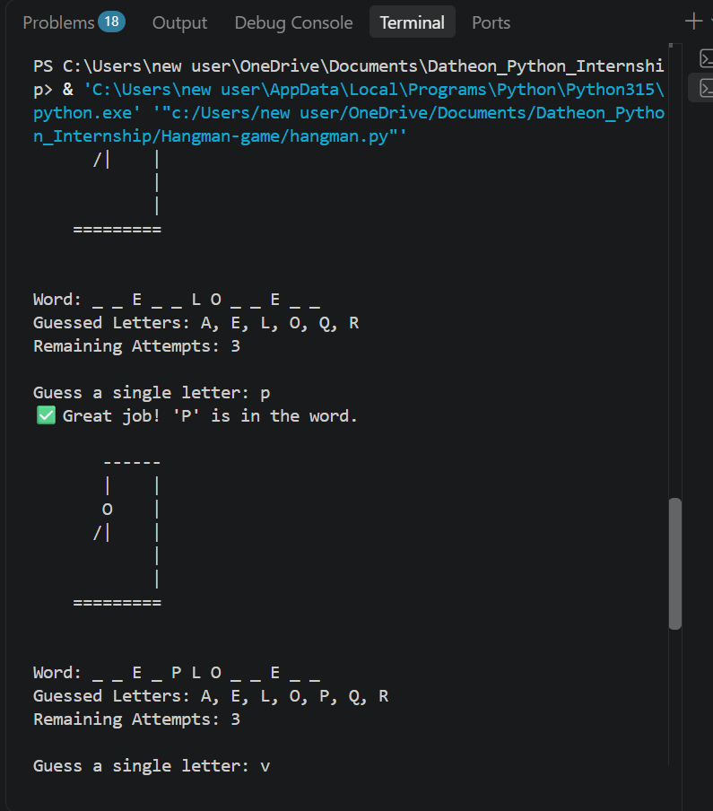
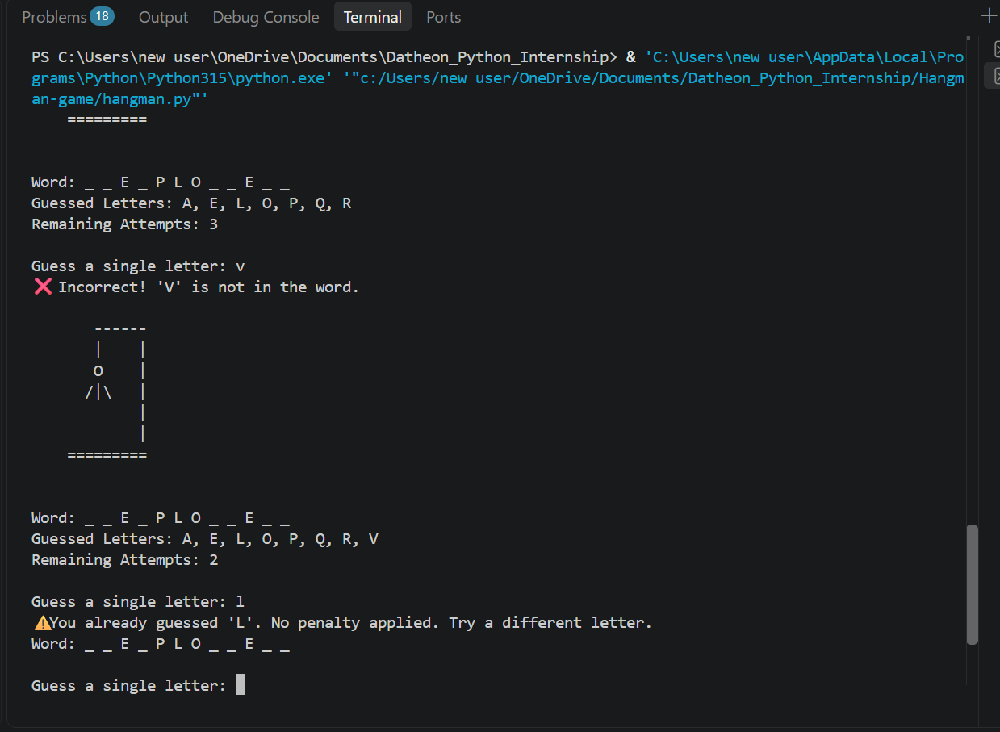
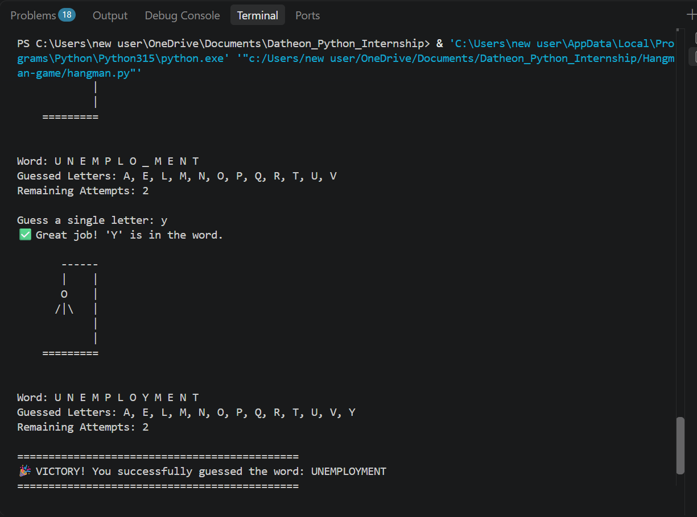
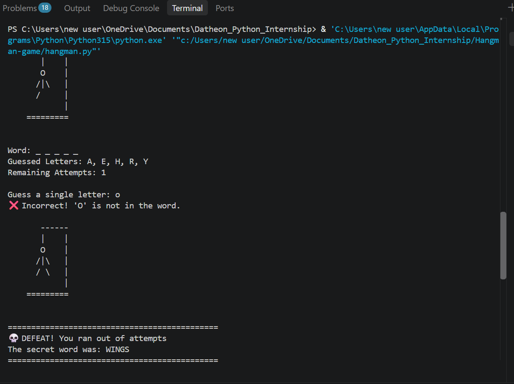
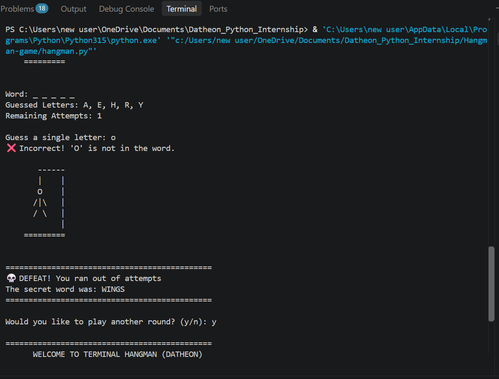

# DATHEON PYTHON INTERNSHIP

## Project 1: Hangman Word Guessing Game

**Internship Programme:** Datheon Python Internship
**Project:** Hangman Word Guessing Game
**Author:** ABDRAFIU ABDMOJEED AYOYINKA
**Programming Language:** Python 3


---

## 1. Project Overview

The Hangman Word Guessing Game is a command-line application developed using Python as part of the **Datheon Python Internship Programme**.

The project implements the classic Hangman word-guessing game, where a player attempts to identify a randomly selected hidden word by guessing one letter at a time.

Players have a maximum of six incorrect guesses before the game ends. Each incorrect guess advances an ASCII representation of the hangman, while correct guesses reveal the corresponding letters in the hidden word.

The application retrieves its vocabulary from an external text file (`words.txt`), validates user input, tracks previously guessed letters, handles common file-related errors, and allows players to start additional rounds without restarting the program.

The project demonstrates practical Python programming concepts, including functions, loops, conditional statements, lists, sets, random selection, file handling, input validation, and exception handling.

## 2. Project Objectives

The main objectives of this project are to:

- Develop an interactive command-line game using Python.
- Apply fundamental Python programming concepts to a practical application.
- Implement random word selection using an external word list.
- Practise file handling and data validation.
- Manage user input and prevent invalid or repeated guesses.
- Implement game logic, win conditions, and loss conditions.
- Improve code organisation through reusable functions.
- Develop a reliable application with basic error handling.

## 3. Features and Functionality

The application includes the following features:

### Core Gameplay

- Random selection of a secret word from an external word list.
- Hidden-word display using underscores.
- Letter-by-letter guessing mechanism.
- Automatic revelation of correctly guessed letters.
- Maximum of six incorrect guesses per round.
- ASCII hangman illustrations representing game progress.
- Automatic detection of victory and defeat.
- Revelation of the secret word when the player loses.

### Input Validation

- Accepts only single English alphabetic letters (A–Z).
- Rejects numbers, symbols, empty inputs, and multiple characters.
- Automatically converts accepted guesses to uppercase.
- Detects previously guessed letters.
- Prevents repeated guesses from reducing the player's remaining attempts.

### Word List Management

- Loads vocabulary from an external `words.txt` file.
- Uses a file path relative to the Python script's location.
- Removes unnecessary whitespace from individual entries.
- Converts loaded words to uppercase.
- Filters out entries that are not composed entirely of ASCII English alphabetic characters.
- Handles missing, inaccessible, empty, or invalid word-list files.

### Replay System

- Allows players to start another round without restarting the application.
- Validates replay responses (`y` or `n`).
- Resets game progress for each new round.
- Displays an exit message when the player chooses to stop.

## 4. Technologies and Python Concepts

| Technology / Concept   | Application                                              |
| ---------------------- | -------------------------------------------------------- |
| Python 3               | Main programming language                                |
| `random` module        | Random word selection                                    |
| `os` module            | File path management and file existence checks           |
| Lists                  | Storing words and ASCII hangman stages                   |
| Sets                   | Tracking guessed letters and checking victory conditions |
| Functions              | Organising game operations into reusable blocks          |
| `while` loops          | Managing gameplay and input validation                   |
| Conditional statements | Processing guesses and game outcomes                     |
| File handling          | Reading the external word list                           |
| Exception handling     | Managing file-related errors                             |
| String methods         | Cleaning, validating, and formatting input               |

**External dependencies:** None. The project uses Python's built-in modules and does not require third-party packages.

## 5. Project Structure

The project is organised within the main Datheon internship repository.

```text
Datheon_Python_Internship/
│
├── Project_1_Hangman/
│   ├── hangman.py
│   ├── words.txt
│   ├── README.md
│   │
│   └── screenshots/
│       ├── welcome.png
│       ├── gameplay.png
│       ├── correct-guess.png
│       ├── invalid-input.png
│       ├── victory.png
│       ├── game-over.png
│       └── replay.png
│
├── Project_2/
├── Project_3/
├── Project_4/
│
└── README.md
```

### File Descriptions

- `hangman.py`: Contains the complete Python implementation and game logic.
- `words.txt`: External text file containing the vocabulary used by the game.
- `README.md`: Documentation explaining the project, installation, features, and usage.
- `screenshots/`: Contains screenshots demonstrating the application's functionality.
- Root `README.md`: Will provide an overview of all projects completed during the Datheon Python Internship.

## 6. Requirements and Installation

### Prerequisites

Before running the application, ensure that you have:

- Python 3 installed on your computer.
- A terminal or command-line interface.
- The project files downloaded or cloned from GitHub.

No additional Python libraries or package installations are required.

### Getting the Project

Clone the main internship repository:

```bash
git clone <YOUR-GITHUB-REPOSITORY-URL>
```

Navigate into the project directory:

```bash
cd Datheon_Python_Internship/Project_1_Hangman
```

### Running the Application

Execute the following command:

```bash
python hangman.py
```

On some systems, you may need to use:

```bash
python3 hangman.py
```

The game will start in the terminal.

## 7. How to Play

1. Launch the application using the appropriate Python command.
2. The game displays a welcome message and selects a random word from `words.txt`.
3. The selected word is displayed as underscores.
4. Enter one English alphabetic letter when prompted.
5. If the letter exists in the hidden word, its corresponding position or positions are revealed.
6. If the letter is incorrect, the hangman illustration advances and one attempt is deducted.
7. Previously guessed letters cannot be used again without penalty.
8. Guess the complete word before reaching six incorrect attempts to win.
9. If all six incorrect attempts are exhausted, the game ends and reveals the secret word.
10. After each round, choose whether to play again.

## 8. Word List Format

The game requires an external file named `words.txt`.

The file must be located in the same directory as `hangman.py`.

Each word should occupy a separate line.

Example:

```text
PYTHON
CIRCUIT
COMPUTER
ENGINEERING
ELECTRONICS
```

The application processes the entries and retains only words containing ASCII English alphabetic characters.

**Important:** Do not rename the file or move it away from the project directory unless you also update the filename or path in the Python code.

## 9. Screenshots and Demonstration

The following screenshots demonstrate the major stages and functionality of the application.

### Welcome Screen

Displays the application's welcome message, initial hangman illustration, and hidden word.




### Gameplay

Shows the interactive guessing process, guessed letters, and remaining attempts.




### Correct Guess

Demonstrates how a correctly guessed letter is revealed in the hidden word.




### Input Validation

Demonstrates how the application identifies and rejects invalid user input.




### Victory Screen

Displays the successful completion of a round after the player correctly guesses the hidden word.




### Game Over

Shows the final hangman illustration and reveals the secret word after six incorrect guesses.




### Replay Functionality

Demonstrates the option to start another round or exit the application.




## 10. Error Handling and Reliability

The application includes basic safeguards to improve reliability.

- Checks whether the required word-list file exists.
- Handles file access errors.
- Detects empty word lists and lists containing no valid entries.
- Validates user guesses before processing them.
- Prevents duplicate guesses from affecting the attempt count.
- Validates replay responses before proceeding.

If the word-list file is missing or invalid, the application displays an appropriate error message instead of starting a game without valid vocabulary.

## 11. Learning Outcomes

Through this project, I gained practical experience in:

- Structuring Python applications using functions.
- Working with external text files.
- Managing data using lists and sets.
- Implementing randomised application behaviour.
- Building interactive command-line applications.
- Validating and processing user input.
- Applying exception handling to file operations.
- Testing different application scenarios and game outcomes.
- Organising project files for documentation and version control.

## 12. Project Completion

This project was developed as part of the **Datheon Python Internship Programme** to demonstrate the practical application of Python programming fundamentals.

The completed application was tested for gameplay functionality, input validation, word-list handling, victory and defeat conditions, and replay functionality.

## 13. Author

**ABDRAFIU ABDMOJEED AYOYINKA**
Developer Identity: **RAFFYDEX**

GitHub: [GitHub Profile](https://github.com/raffydex)

---

*Developed and documented as part of the Datheon Python Internship Programme.*
