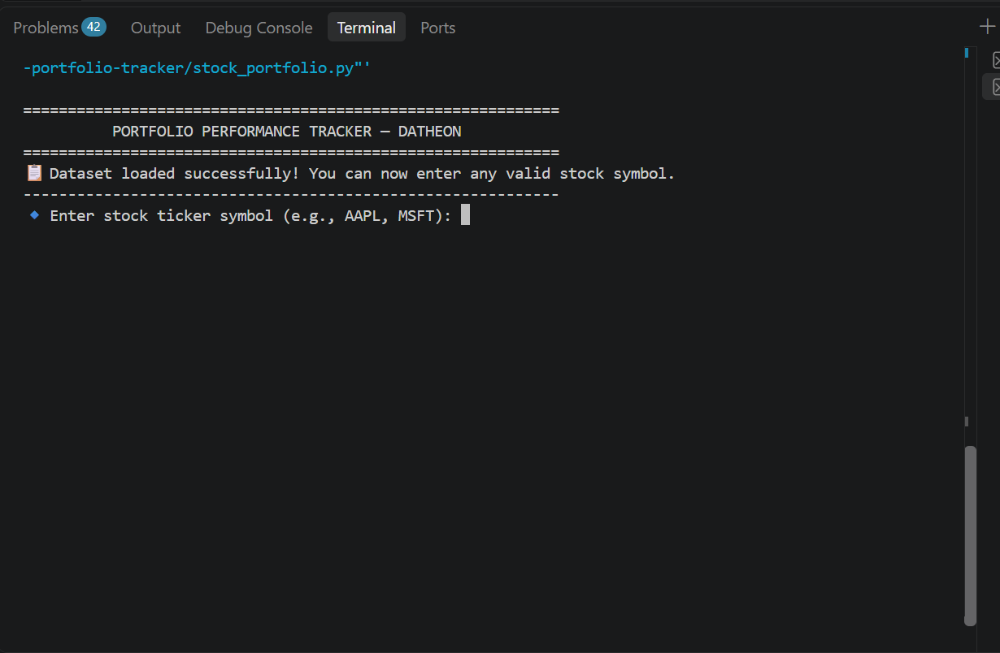
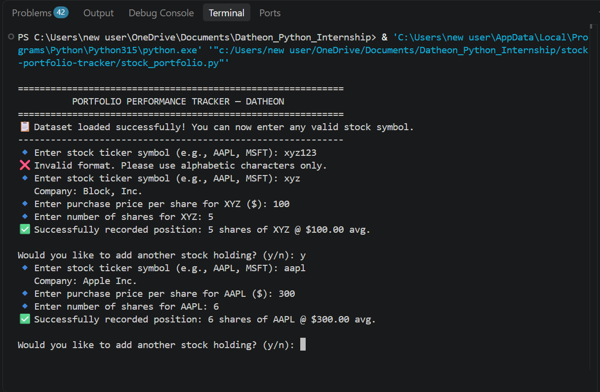
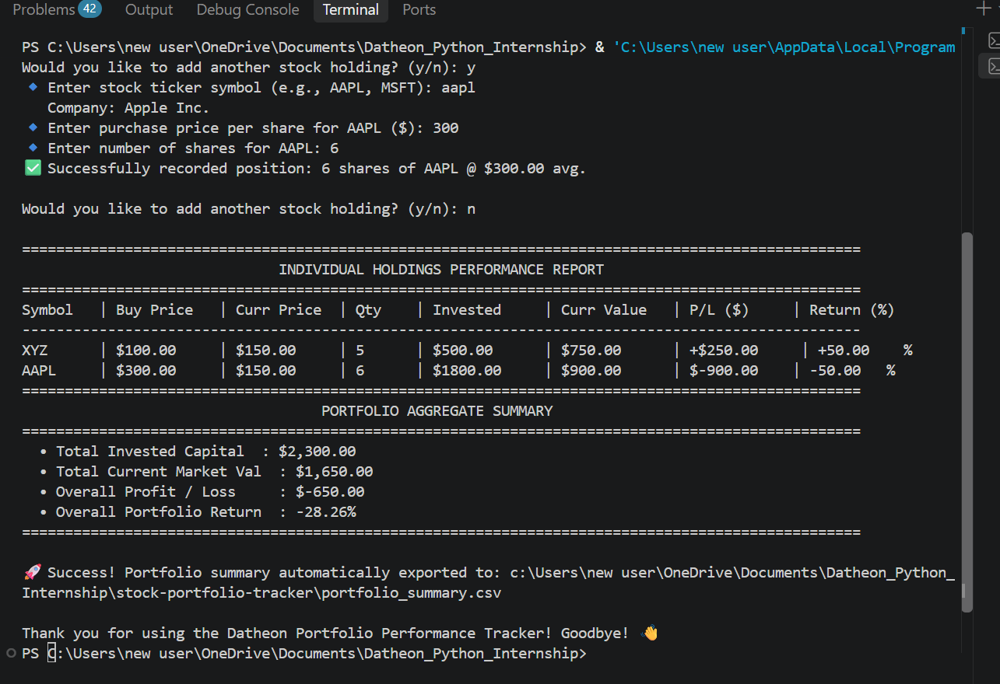
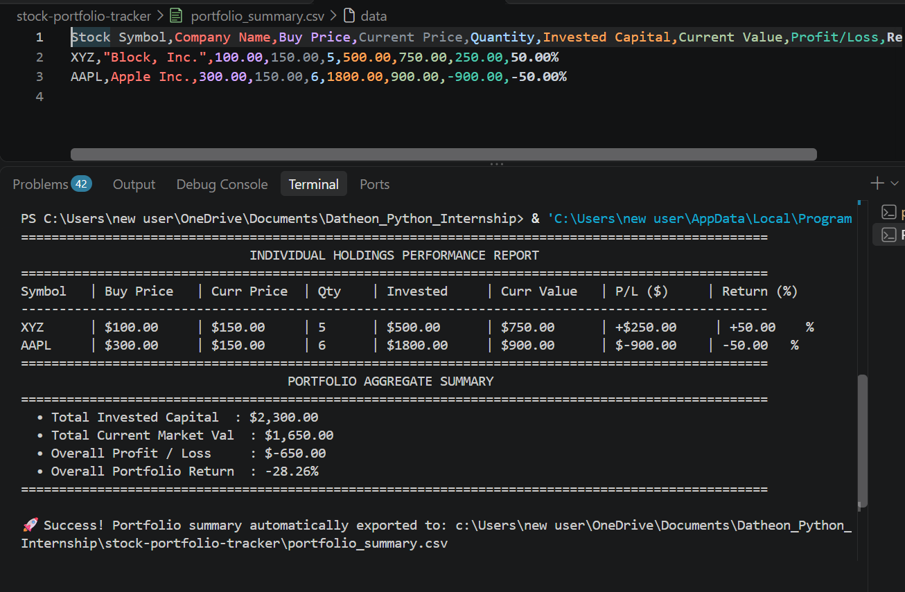

# Stock Portfolio Performance Tracker

**Datheon Python Programming Internship — Project 2**

A beginner-friendly, command-line Stock Portfolio Performance Tracker developed using Python. The application allows users to record stock holdings, calculate investment performance, monitor individual stock positions, and automatically export portfolio reports to a CSV file.

---

## Project Overview

The Stock Portfolio Performance Tracker is a Python-based application designed to help users monitor their stock investments through a simple interactive terminal interface.

Users can enter stock ticker symbols, specify their purchase prices and share quantities, and generate a performance report showing their invested capital, current portfolio value, profit or loss, and percentage returns.

The application uses an S&P 500 company dataset to validate stock symbols and retrieve company names. Since the supplied dataset does not contain actual market prices, the application uses a simulated baseline market price of **$150.00 per share** for every supported stock.

This project demonstrates practical applications of Python programming, including file handling, data processing, user input validation, dictionary operations, functions, calculations, and CSV file generation.

## Key Features

- **Stock Symbol Validation:** Checks whether an entered stock ticker exists in the supplied company dataset.
- **Company Identification:** Retrieves and displays the corresponding company name for a valid ticker.
- **Investment Input:** Accepts the purchase price per share and the number of shares purchased.
- **Multiple Stock Holdings:** Allows users to add multiple stocks to their investment portfolio.
- **Duplicate Stock Management:** Combines repeated entries for the same stock and calculates their weighted average purchase price.
- **Portfolio Valuation:** Calculates the total invested capital and estimated current portfolio value.
- **Profit and Loss Calculation:** Determines the profit or loss for each individual stock holding.
- **Percentage Return:** Calculates the percentage gain or loss for individual holdings and the overall portfolio.
- **Formatted Performance Report:** Displays investment information in an organised terminal table.
- **Automatic CSV Export:** Saves individual holding records and their performance metrics to an external CSV file.
- **Input Validation and Error Handling:** Handles invalid numerical entries, unsupported stock symbols, missing datasets, and file access errors.

## Technologies Used

| Technology | Purpose |
|---|---|
| Python 3 | Core programming language |
| CSV Module | Reading the company dataset and exporting portfolio reports |
| OS Module | File path management and file existence checks |
| Dictionaries | Storing stock information and portfolio holdings |
| Functions | Organising application operations into reusable sections |

**Dependencies:** The project uses Python's built-in libraries. No additional Python packages are required.

## Project Structure

```text
Project_2_Stock_Portfolio/
│
├── portfolio.py
│
├── market_prices.csv
│
├── portfolio_summary.csv
│
├── README.md
│
└── screenshots/
    ├── welcome.png
    ├── portfolio-entry.png
    ├── performance-report.png
    └── csv-export.png
```

*Note: `portfolio_summary.csv` is automatically generated when the application completes a portfolio calculation and successfully exports the report.*

## Dataset Information

The application uses `market_prices.csv`, a company dataset containing S&P 500 stock information.

The dataset includes the following columns:

- Symbol
- Security
- GICS Sector
- GICS Sub-Industry
- Headquarters Location
- Date Added
- CIK
- Founded

The application specifically uses the `Symbol` and `Security` columns to validate stock tickers and identify company names.

**Important:** The supplied dataset does not contain stock market prices. Therefore, this implementation uses a simulated current price of $150.00 per share for demonstration and testing purposes. It does not retrieve live or real-time stock market data.

## How to Run the Application

### 1. Install Python

Ensure that Python 3 is installed on your computer.

You can verify your installation by running:

```bash
python --version
```

### 2. Clone or Download the Repository

Download the project files or clone the repository to your local computer.

### 3. Open the Project Folder

Open `Project_2_Stock_Portfolio` in Visual Studio Code or navigate to the folder through your terminal.

### 4. Run the Application

Execute the following command:

```bash
python portfolio.py
```

### 5. Enter Your Stock Information

Follow the terminal prompts to:

1. Enter a supported stock ticker symbol.
2. Enter the purchase price per share.
3. Enter the number of shares purchased.
4. Choose whether to add another stock holding.
5. View your portfolio performance report.

### 6. Access the Generated Report

After successful execution, the application automatically creates:

```text
portfolio_summary.csv
```

The generated file is saved in the same directory as `portfolio.py` and can be opened using Microsoft Excel or other spreadsheet applications.

## Portfolio Calculations

The application uses the following formulas:

**1. Invested Capital**

```text
Invested Capital = Buy Price × Quantity
```

**2. Current Portfolio Value**

```text
Current Value = Current Price × Quantity
```

**3. Profit or Loss**

```text
Profit/Loss = Current Value - Invested Capital
```

**4. Percentage Return**

```text
Return (%) = (Profit/Loss / Invested Capital) × 100
```

**5. Overall Portfolio Performance**

The overall portfolio profit or loss is calculated by subtracting the total invested capital from the total current portfolio value.

The overall percentage return is calculated using the total portfolio profit or loss divided by the total invested capital, multiplied by 100.

## Application Screenshots

The following screenshots demonstrate the application's interface and major functionalities.

### 1. Application Welcome Screen

Displays the application title, welcome message, and initial stock entry prompt.



### 2. Portfolio Entry

Demonstrates how users enter stock ticker symbols, purchase prices, share quantities, and add multiple holdings to their portfolios.



### 3. Portfolio Performance Report

Displays the calculated performance of individual stock holdings, including purchase prices, current prices, invested capital, current values, profit or loss, and percentage returns.



### 4. CSV Export Confirmation

Demonstrates the successful automatic generation and saving of the portfolio summary CSV file.



## Error Handling and Input Validation

The application includes validation mechanisms to improve reliability and prevent common input errors.

Examples include:

- Rejecting unsupported stock ticker symbols.
- Rejecting incorrectly formatted ticker entries.
- Rejecting zero or negative purchase prices.
- Rejecting invalid numerical values.
- Rejecting zero or negative share quantities.
- Validating the user's response when asked whether to add another stock.
- Detecting missing or empty company datasets.
- Handling errors encountered while reading or writing CSV files.

## Learning Outcomes

Developing this project provided practical experience with:

- Python functions and modular programming.
- Variables, dictionaries, and data structures.
- Loops and conditional statements.
- User input and input validation.
- Exception handling using `try` and `except`.
- Reading external CSV datasets with `csv.DictReader`.
- Writing structured CSV reports using `csv.DictWriter`.
- File handling and directory management.
- Financial calculations and percentage-based performance analysis.
- Building interactive command-line applications.

## Project Limitations

This version is designed primarily for learning, demonstration, and testing.

- Stock prices are simulated using a fixed baseline of $150.00 per share.
- The application does not connect to a live stock market API.
- Only stock symbols contained in the supplied dataset are accepted.
- Portfolio information is exported to CSV rather than stored in a database.
- The application does not provide automated trading or investment recommendations.

## Author

**ABDRAFIU ABDMOJEED AYOYINKA**

Developer Name: **RAFFYDEX**

**Programme:** Datheon Python Programming Internship

**Project:** Stock Portfolio Performance Tracker — Project 2

---

*Built with Python as part of my journey towards developing practical programming, problem-solving, and software development skills.*